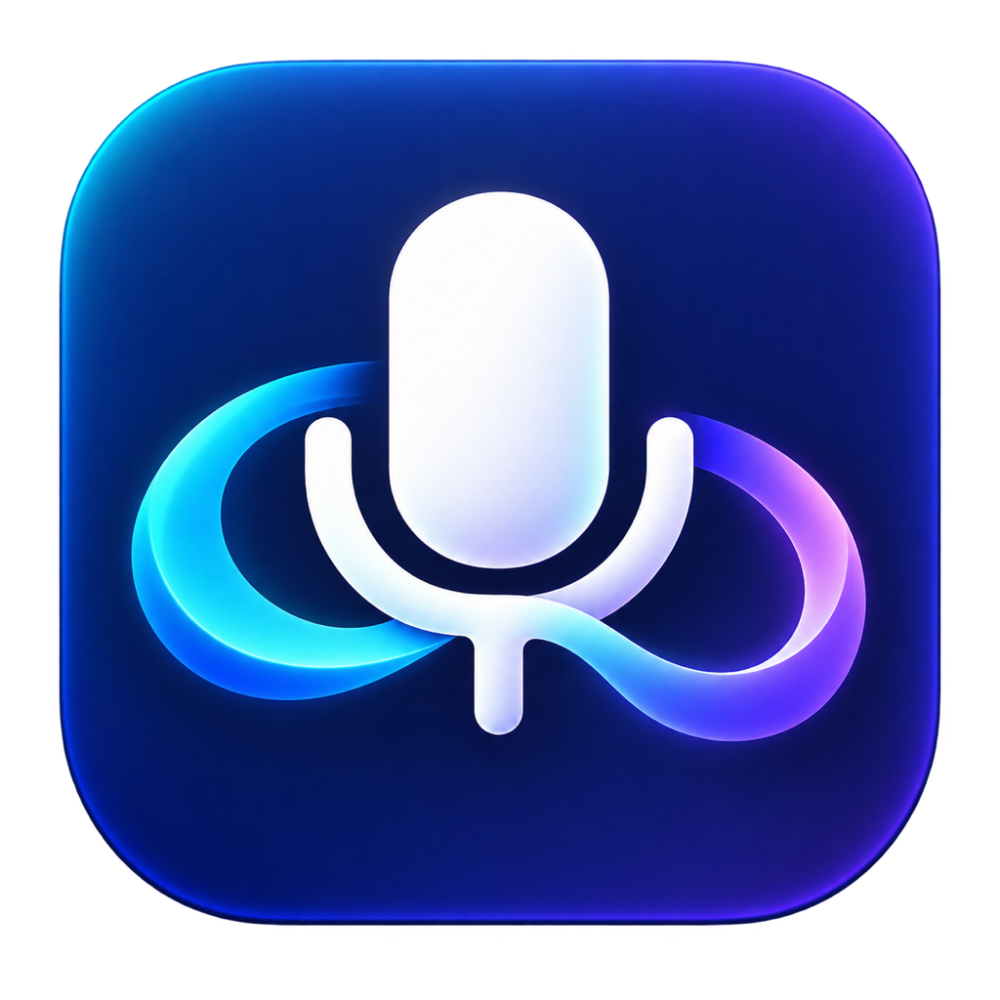

<p align="center">
  
</p>

# LARK Flow Bridge: Hollyland LARK A2 microphone button for Wispr Flow on macOS

**Click your LARK A2 microphone button once to start Wispr Flow dictation, then click it again to stop.** LARK Flow Bridge is a small, native Swift macOS app that connects the Hollyland LARK A2 USB-C receiver to Wispr Flow's hands-free recording shortcut.

This community utility was built for an A2 receiver whose latest offered firmware, **3.0.2.008**, did not answer Hollyland Web Control's AI-template commands. It uses the microphone's existing noise-cancellation button signal, restores the original sound setting, and sends Flow's **Fn + Space** shortcut. Audio continues to go directly from the wireless microphone to Wispr Flow.

[Download the macOS app](https://github.com/geekyshubham/lark-flow-bridge/releases/latest) · [Setup and prerequisites](#prerequisites) · [Troubleshooting](docs/TROUBLESHOOTING.md) · [How it works](docs/HOW_IT_WORKS.md) · [Report a problem](https://github.com/geekyshubham/lark-flow-bridge/issues/new/choose)

## Features

- View live battery percentages, connection, charging and mute status for both LARK A2 microphones.
- Read the receiver firmware and adjust noise cancellation while the bridge is stopped.
- Start and stop Wispr Flow with the physical LARK A2 transmitter button.
- Restore the microphone's original noise-cancellation setting before sending a shortcut.
- Work around unavailable AI-mode/button-template commands on the tested A2 firmware.
- Read only the matching Hollyland receiver's control reports; no audio, typed text, or transcripts are captured by the bridge.
- Run locally without accounts, API keys, network requests, or third-party libraries.
- Use a native macOS interface with a microphone/link app icon.

## LARK A2 battery monitor and microphone controls for Mac

Version 1.1 adds a live dashboard for both transmitters:

| Feature | Available in this Mac app |
| --- | --- |
| Microphone 1 and 2 battery percentage | Yes, reported by the receiver; unknown/offline shows — |
| Connected, charging and muted status | Yes, read-only status for each microphone |
| Receiver firmware version | Yes |
| Noise cancellation | Off, Low, Medium and High; stop the bridge before changing it |
| Gain, sound tuning, channel mode, LED and power settings | Continue using HollyAudio on Android/iOS; USB write commands are not verified here |
| Firmware updates | Use the official HollyAudio mobile app |

The dashboard starts automatically and keeps refreshing when the bridge is stopped. Accessibility permission is needed for dictation shortcuts, not the battery display. Changes made using this app's noise control are confirmed with the receiver and never generate a dictation shortcut. Keep other receiver controllers closed.

## Prerequisites

| Requirement | Details |
| --- | --- |
| Mac | macOS 13 or later is the build target. Live testing was performed on macOS 26.3 with Apple Silicon. |
| Architecture | Release bundles contain Apple Silicon (`arm64`) and Intel (`x86_64`) binaries. Intel is compiled but has not been tested with physical hardware. |
| Microphone | Hollyland LARK A2 with the **USB-C mobile receiver**, connected to the Mac and paired with a powered-on transmitter. |
| Receiver identity | USB vendor `0x3547`, product `0x0411`. Camera receivers and other LARK models are not supported by this version. |
| Firmware | Verified with receiver firmware **3.0.2.008**. Other firmware versions need hardware testing. |
| Wispr Flow | Installed, signed in, and running. Select **Wireless (USB)** as its dictation microphone. |
| Flow shortcut | Keep the hands-free start/stop shortcut set to **Fn + Space**. |
| Accessibility | Enable **LARK Flow Bridge** in System Settings → Privacy & Security → Accessibility. This allows shortcut generation. |
| USB access | If the bridge reports USB access denied, grant the bridge Input Monitoring access and reopen it. This is conditional, not a microphone/audio permission. |
| Other controllers | Keep Hollyland Web Control and other receiver-setting tools closed while using the bridge. |

The bridge has no additional transcription service or subscription. Wispr Flow handles audio, transcription, connectivity, and account limits under its own settings.

## Quick start: use the LARK A2 button with Wispr Flow

1. Download `LARK-Flow-Bridge-macOS-universal.zip` from [Releases](https://github.com/geekyshubham/lark-flow-bridge/releases/latest) and extract it.
2. Move **LARK Flow Bridge.app** into Applications or your personal `~/Applications` folder.
3. Connect the LARK A2 USB-C receiver to your Mac and power on the transmitter.
4. Open Wispr Flow. In Settings → General → Microphone, choose **Wireless (USB)**. Confirm the hands-free shortcut is **Fn + Space**.
5. Open LARK Flow Bridge and click **Start bridge**. Grant its Accessibility permission when macOS asks, then return and start it again.
6. Wait for **Ready. Click the transmitter to start or stop Flow.**
7. Place your cursor in a text field. Click the microphone button once, speak after Flow starts, and click again to stop and transcribe.

Keep both apps running. You can minimize the bridge; closing its window quits it. After restarting your Mac, reopen it and click **Start bridge**. Automatic launch at login is not included in this version.

### First launch and macOS security

The downloadable app is **ad hoc signed and not Apple-notarized**. `codesign` verification checks bundle integrity, but this is not a Developer ID signature or an Apple review. You can build the open source locally instead of using a binary.

macOS may block an internet-downloaded build. Review [Apple's app-opening guidance](https://support.apple.com/102445) and decide whether to allow this specific app in Privacy & Security. The setup does not require disabling Gatekeeper, SIP, or system-wide security settings.

To check the downloaded archive's checksum, place `SHA256SUMS.txt` beside the ZIP and run:

```sh
shasum -a 256 -c SHA256SUMS.txt
```

## How the microphone button controls recording


The bridge checks the receiver's status five times per second. It infers a click from a noise-setting change rather than reprogramming the transmitter firmware. It then restores the remembered setting, waits for confirmation, and generates Flow's existing shortcut. This supports **click to start / click to stop**, not hold-and-release recording.

See [protocol and implementation details](docs/HOW_IT_WORKS.md).

## Known limitations

- Any change to the receiver's reported noise state can be interpreted as a click, including a receiver button or another control app. Stop the bridge before adjusting noise settings. The built-in noise control is enabled only while the bridge is stopped.
- The bridge sends a toggle; it does not read Flow's recording state. Use Flow's recording indicator to confirm a session. The bridge's counter counts shortcuts sent.
- Very fast clicks during restoration or its short debounce interval may be ignored. Allow Flow to start before clicking again.
- Holding Shift, Control, Option, Command, or Fn suppresses shortcut generation to avoid mixing it with another key combination.
- Firmware updates or changes to the USB protocol can affect compatibility. Only the hardware/firmware listed above has been verified.
- Replacing or rebuilding an ad hoc signed app can require granting Accessibility permission again. See [permission troubleshooting](docs/TROUBLESHOOTING.md#accessibility-is-enabled-but-the-app-still-asks-for-access).

## Build from source

Install Apple's [Xcode Command Line Tools](https://developer.apple.com/documentation/xcode/installing-the-command-line-tools) if needed:

```sh
xcode-select --install
```

Build on macOS with Swift 5.7 or newer, a macOS SDK, and the tools bundled with macOS/Xcode. No Homebrew, Python, Node.js, or Swift package dependencies are needed.

```sh
git clone https://github.com/geekyshubham/lark-flow-bridge.git
cd lark-flow-bridge
./scripts/build.sh                 # Build for the current Mac architecture
./scripts/build.sh --universal     # Include Apple Silicon and Intel
./scripts/test.sh                  # Exercise receiver status and setting safety fixtures
./scripts/check.sh                 # Verify a universal app bundle
./scripts/package.sh               # Create release ZIP and SHA-256 checksum
```

The app is written to `build/LARK Flow Bridge.app`. Distribution files are written to `dist/`. The build signs the app ad hoc. [Release instructions](docs/BUILDING.md) also cover optional Developer ID signing and notarization for maintainers who have their own Apple credentials.

## Frequently asked questions

### Can I start Wispr Flow with a Hollyland LARK A2 microphone button?

Yes, on the verified setup this bridge turns a transmitter click into Flow's hands-free start/stop shortcut. Keep Flow and the bridge running and focus a text field before dictating.

### Why does HollyAudio ask me to connect the receiver to a phone?

HollyAudio is the mobile settings and firmware-update app. The iPhone/iPad version running on an Apple Silicon Mac did not detect the USB accessory-control connection in our setup. Hollyland provides a separate [LARK A2 desktop Web Control page](https://res.hollyland.com/6118/index.html). This bridge is a fallback when the receiver does not respond to its AI-template requests.

### HollyAudio says my LARK A2 firmware is already up to date. What now?

An up-to-date result means the mobile app has no update to offer your unit. It does not by itself confirm desktop AI-template support. This project was verified with **3.0.2.008**, which returned basic microphone status but did not answer the tested AI-template command. Do not flash firmware intended for another model or assume that every A2 variant behaves identically.

### Why does the microphone light briefly switch between blue and green?

The original button toggles noise cancellation. The bridge detects that change and restores the starting setting before sending Flow's shortcut. A brief indicator change during a click is expected.

### Does LARK Flow Bridge record or upload my voice?

The bridge contains no audio capture, transcription, or network code. It reads receiver control status, sends noise-setting commands, and generates a keyboard shortcut. Wispr Flow separately handles your audio and transcription.

### Is this an official Hollyland or Wispr app?

This is an independent community project by [geekyshubham](https://github.com/geekyshubham). Hollyland and Wispr Flow product names are used to explain device compatibility.

## Project files

- [`LARKFlowBridge.swift`](LARKFlowBridge.swift): complete native app source.
- [`scripts/`](scripts/): build, icon, package, and verification commands.
- [`docs/TROUBLESHOOTING.md`](docs/TROUBLESHOOTING.md): permission, USB, and recording problems.
- [`docs/HOW_IT_WORKS.md`](docs/HOW_IT_WORKS.md): control protocol, safeguards, and privacy behavior.
- [`assets/`](assets/): source PNG, app icon, and macOS ICNS asset.
- [`docs/ICON_DESIGN.md`](docs/ICON_DESIGN.md): icon generation prompt and provenance.

## License

[MIT](LICENSE). Contributions and hardware compatibility reports are welcome.
